<p align="center">
  
</p>

<h1 align="center">Chest Counter</h1>

<p align="center">
  A Fortnite overlay that counts the chests you open: in this match, this session and in total.<br />
  Live while you play, exact after every match, built for the treasure hunt.
</p>

<p align="center">
  <a href="https://github.com/basspunks/fortnite-chest-counter/releases/latest"><b>Download ChestCounter.exe</b></a>
  ·
  <a href="#features">Features</a>
  ·
  <a href="#how-it-works">How it works</a>
  ·
  <a href="#build-from-source">Build from source</a>
</p>

<p align="center">
  
</p>

> **Unofficial fan project.** Not affiliated with, endorsed or sponsored by Epic Games. Fortnite is a trademark of
> Epic Games, Inc.

## Download

1. Download **ChestCounter.exe** from the [latest release](https://github.com/basspunks/fortnite-chest-counter/releases/latest).
2. Double-click it. There is no installer: the counter appears under the minimap and a small icon appears next to
   the clock.
3. In Fortnite, turn on **Settings → Game → Replays → Record Replays** (needed for the exact count).
4. Play in **Windowed Fullscreen** (*Settings → Video → Window Mode*). In exclusive fullscreen, Windows cannot draw
   anything over the game.

> [!NOTE]
> **Replays must be turned on** (*Settings → Game → Replays → Record Replays: On*). The exact count of each match comes
> from its replay. Without replays, the counter only has the live count (screen and sound), which can miss a chest, so
> the results will not be 100% accurate.

The exe is not code-signed yet, so Windows SmartScreen may say it "protected your PC" the first time.
Click **More info → Run anyway**.

Requires Windows 10 (version 2004 or newer) or Windows 11.

## Features

### The counter

- **HUD-style bar** under the minimap: Match, Session and Total, outlined like the game's own numbers, with your last
  matches and your average underneath.
- **Click-through**: the mouse goes straight to the game. Only the settings button reacts when you point at it.
- **Light on your FPS**: the bar has no running animations and is only redrawn when something on it changes. While
  counting, the whole app uses about 1–3% of one CPU core, plus about 6% of one core in matches while it reads the
  screen (well under 1% of a 6-core CPU).
- **Exact count after every match**: when a match ends, Fortnite's replay of it is read and its exact number of chests
  replaces the live count. Match, Session, Total and the history are corrected, and you see how many of the
  chests were broken rather than opened.
- **New matches start by themselves**, from Fortnite's own log. Nothing is counted in the lobby.
- **Open with Fortnite**: starts with Windows, waits next to the clock, and shows the counter only while the game
  runs.
- **Position lock**: unlock it, drag the bar anywhere, lock it again.
- **Controller support**: add, undo, start a match or show / hide the bar with any controller button or button
  combination, while the game keeps the focus. Keyboard shortcuts work too.

<p align="center">
  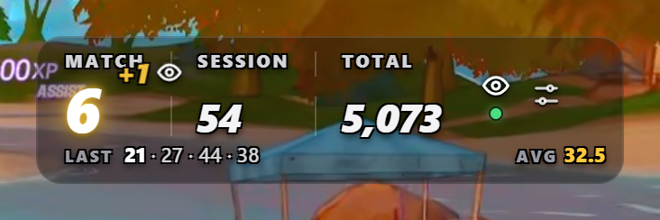
  &nbsp;
  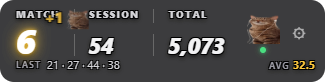
  <br />
  <sub>A chest heard live, and the same in cat mode</sub>
</p>

<p align="center">
  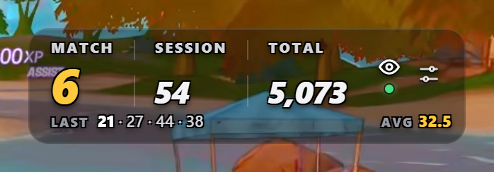
  
  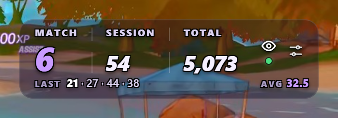
  <br />
  <sub>The three themes: Dark, Midnight and Storm</sub>
</p>

### Treasure hunt stats

- **This week's prizes** and the **next Treasure Hour**, in your own time zone, with a Windows notification 5 minutes
  before it starts.
- **Your chances**: the chance you have already got each prize, from the chests you opened (Treasure Hour boosts
  included).
- **Report**: chests in total, matches, average, best match, chest kinds, treasures found, and an approximate squad
  total.
- **Collection** with pictures: prizes found in your replays are marked; anything you got another way can be ticked by
  hand.
- **Chests from before**: add them by hand, or estimate them from the number of matches in Fortnite's Career tab.
- **Treasure hunt matches only** (optional): ranked, creative, LTMs and private matches are kept out of the totals.

<p align="center">
  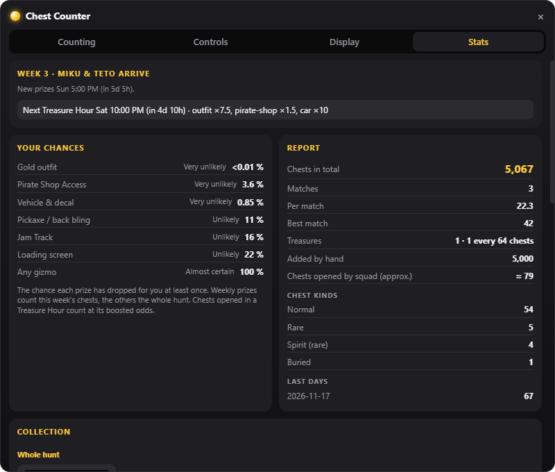
  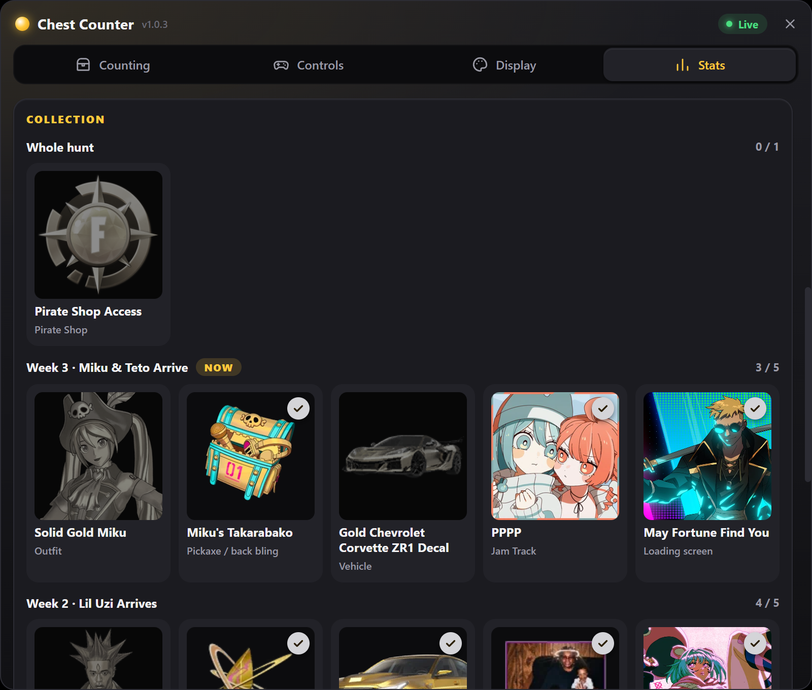
</p>

### Controls and display

- **Keyboard**: Add chest `F8`, Undo `F7`, New match `F9`, Show / hide bar `Ctrl+Shift+O`. Any key can be used.
- **Controller**: any button or button combination for each action.
- **Themes** (Dark, Midnight, Storm) and background opacity.
- **Cat mode** (optional): a cat with earphones listens for the chests in place of the headphones icon.
- **OBS page**: the same numbers on a transparent page you can add as a Browser source in OBS.
- **Replay cleanup**: Fortnite's old unsaved replays can be moved to the Recycle Bin in one click (the newest and
  the ones you saved are never touched).
- **Updates**: the app tells you when a new version is out and updates itself in one click.

<p align="center">
  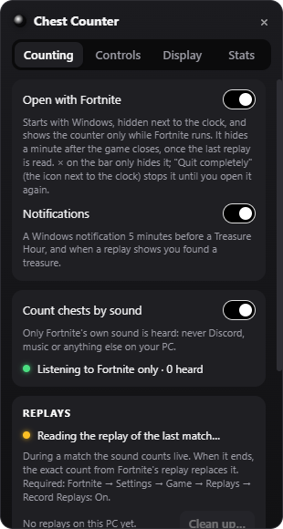
  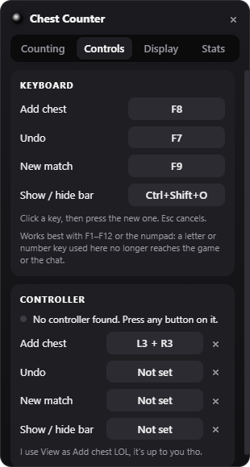
  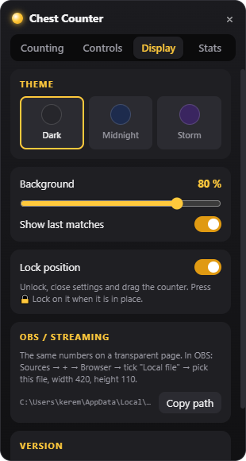
</p>

## How it works

### Exact count: replays

Fortnite records a replay of every match. When a match ends, Chest Counter reads it with a small bundled program
(`chest-replay.exe`) and takes the number of chests you opened, their kinds, the treasures you found and the chests
your teammates opened near you. That number is final: it replaces whatever was counted live.

### Live count: the "+XP CHEST" text on screen

When you open a chest, Fortnite shows "+600 XP" with the word **CHEST** under it, right of the crosshair. During
matches, the counter looks at that small area five times a second and counts each new CHEST it reads there. Each look
is dropped at once: nothing is recorded, saved or sent. It needs **Windowed Fullscreen** (in exclusive fullscreen
Windows gives no picture of the game; the settings then say so and the sound counts instead). You can turn it off in
*Settings → Counting*.

Checked on 4 clips against the matches' own replays, it read 68 of the 70 chests opened, with 2 false alarms (the
sound found 47). It cannot see chests that were broken rather than opened, or the ones your teammates open: the replay
counts those after the match.

### Live count: sound (backup, in development)

While the screen is read, the sound no longer counts on its own; it counts when screen reading is off or cannot work.


> **Counting by sound is still in development.** It is good enough to follow a match live, but it can miss a chest or
> count one too many (a wall breaking near a chest, for example). This does not affect your totals: every match is
> replaced by its exact replay count when it ends. Detection will keep improving in the next versions.

A closed chest plays a steady hum. When it opens, the hum stops and a short burst plays. The counter listens for
exactly that, in **Fortnite's own sound only**, captured through Windows' per-application audio capture (the same
feature OBS uses). Discord, music or anything else on your PC is never heard. If Windows cannot capture Fortnite on its
own, counting by sound stays off and you can count with your keys or controller.

The detector learned from real matches: 13 recorded clips in which every sound that looked like a chest was checked
against the video (91 chest openings, and 60 look-alikes such as breaking boxes and walls, doors and shots). What
tells them apart best is how long the hum was heard before: a chest hums the whole time you walk up to it.
Tested on clips it had not learned from, it finds about 86% of the chests, against 68% for the first version (unreleased).
It was then checked against 4 more clips, this time using the matches' own replays as the answer: it heard 48 of the
63 chests opened there, with 2 false alarms. Still often missed: spirit chests (behind the vault doors), chests broken
rather than opened (they make no opening sound) and a chest opened right next to another one. The replay counts them
all after the match.

Below, spectrograms of those recordings (time from left to right, pitch from bottom to top).

<p align="center">
  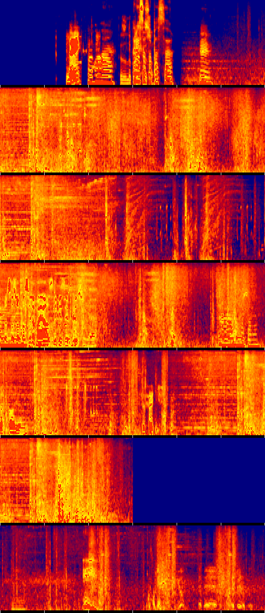
  &nbsp;
  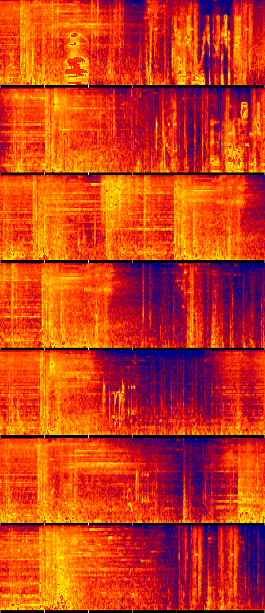
</p>

The same openings in the gameplay footage, frame by frame, used to line up sound and picture:

<p align="center">
  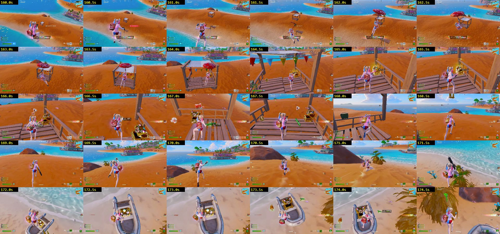
</p>

Short clips were also checked one frame per second, to find chests the detector did not even notice:

<p align="center">
  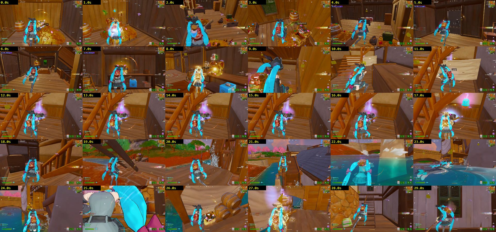
  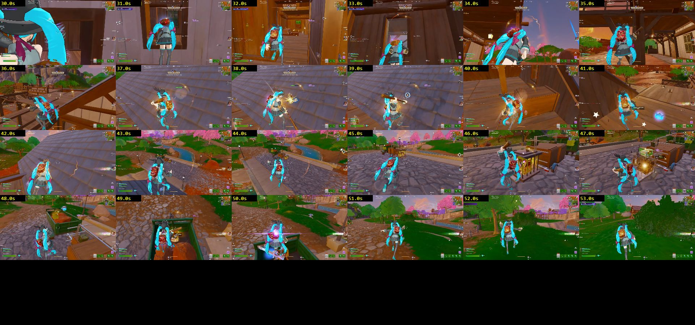
  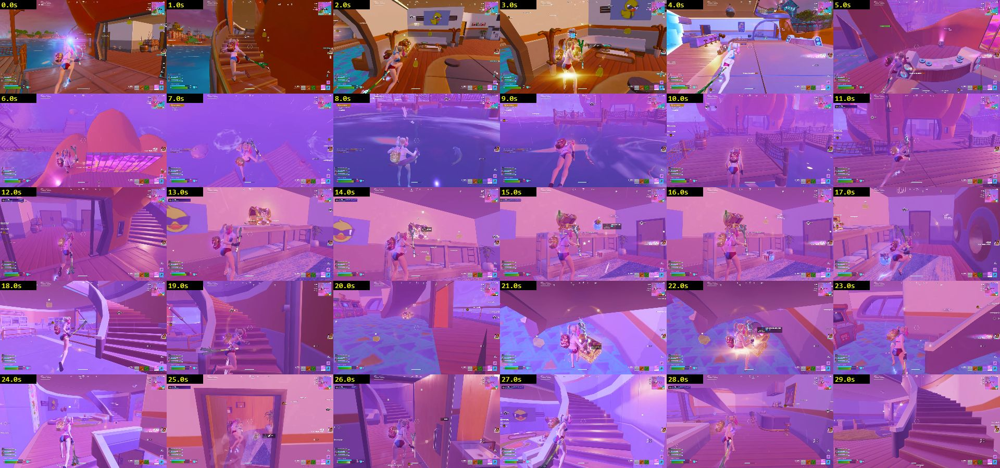
</p>

## Is it safe?

Chest Counter never touches the game: no injection, no memory reading, nothing in the Fortnite folder. It only reads
what Fortnite writes for everyone:

| What | Where | Why |
|---|---|---|
| Replays (read-only) | `%LOCALAPPDATA%\FortniteGame\Saved\Demos` | The exact count after each match |
| Log | `%LOCALAPPDATA%\FortniteGame\Saved\Logs\FortniteGame.log` | When a match starts and ends |
| Fortnite's sound | Windows per-application audio capture | The live count |
| The "+XP CHEST" area of the screen | Windows screen capture, during matches only, never saved | The live count |

Nothing is sent anywhere. The app only downloads the treasure hunt data, the prize pictures, and checks GitHub for a
newer version. Your data (total, history, settings) stays in `%APPDATA%\chest-counter`.

## Build from source

You need [Node.js](https://nodejs.org/) and the [.NET 10 SDK](https://dotnet.microsoft.com/download/dotnet/10.0) on
Windows.

```bash
npm install
npm run replay-reader   # builds replay-reader/bin/chest-replay.exe
npm start
```

```bash
npm test                # runs the tests (Vitest)
npm run dist            # builds release/ChestCounter.exe (one portable file)
```

| Path | What |
|---|---|
| `src/main.ts` | The app: windows, tray, keys, matches, replays, updates, settings |
| `src/renderer.ts`, `index.html`, `style.css` | The counter bar and the settings / stats window |
| `src/chest-text.ts` | Reading the word CHEST under "+XP" on screen |
| `src/detector.ts` | The chest sound detector (hum stops, then a burst) |
| `src/game-audio.ts`, `native/app-audio.ps1` | Hearing only Fortnite's sound (Windows process loopback) |
| `src/match-log.ts`, `src/match-tracker.ts` | Match start and end from Fortnite's log; one record per match |
| `src/replays.ts`, `replay-reader/` | Reading a replay: exact chest count, treasures and teammates |
| `src/content.ts`, `src/records.ts`, `content/content.json` | Treasure hunt data, chances, collection and report |
| `src/updater.ts`, `src/obs.ts` | Updates from GitHub Releases, the OBS page |
| `test/` | Tests |

## Credits

- Replay analysis adapted from [LED-N/Fortnite-ChestCounter](https://github.com/LED-N/Fortnite-ChestCounter) (MIT,
  see `replay-reader/LICENSE-Fortnite-ChestCounter`).
- Replay parsing by [FortniteReplayDecompressor](https://github.com/Shiqan/FortniteReplayDecompressor) by Shiqan (MIT,
  see `replay-reader/lib/LICENSE-FortniteReplayDecompressor`; changes listed in `replay-reader/lib/PATCHES.md`).
- Treasure hunt data (`content/content.json`) from LED-N/Fortnite-ChestCounter (MIT). Prize pictures are loaded from
  fortnite.bot; apart from the screenshots above, they are not part of this repository.

## License

[MIT](LICENSE) © basspunks
